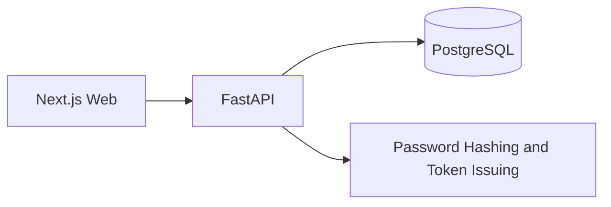

# LMS SaaS Architecture

## Boundaries

- `apps/web`: user interface and CRM dashboard.
- `apps/api`: API, auth, business entities, and persistence.
- `database`: reference SQL schema; runtime schema changes are applied through Alembic.
- `docs`: generated architecture, security, and product notes.
